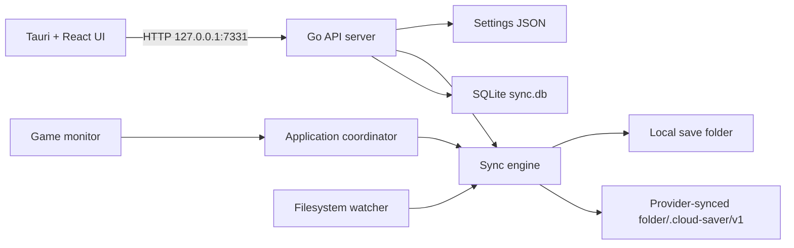

# Cloud Saver developer guide

This guide describes the current Windows-focused implementation for contributors working on the Go daemon or Tauri/React desktop UI.

## Repository map

```text
app/                         Tauri shell and React UI
  src/api.ts                 Typed local HTTP client
  src/api/parsers.ts         Defensive API response normalization
  src/views/                 Home, games, game detail, settings, activity
  src-tauri/                 Native desktop wrapper
backend/
  cmd/daemon/                Daemon entry point
  internal/app/              Service composition and lifecycle
  internal/api/              Loopback HTTP API and handlers
  internal/config/           JSON settings and game configuration
  internal/syncer/           Job engine and synced-folder protocol
  internal/snapshots/        Local incremental snapshot vault
  internal/backup/           ZIP export/import and auto-backup services
  internal/logstore/         SQLite logs, playtime, sync state, conflicts
  internal/watcher/          fsnotify integration
```

## Runtime architecture



`internal/app.Application` constructs and starts the config manager, SQLite store, sync engine, watcher, game monitor, backups, snapshots, local HTTP server, and optional tray. The HTTP server is loopback-only and permits only loopback origins for CORS.

## Configuration and persistence

### Settings JSON

The config manager stores settings under `%AppData%/CloudSaver/settings.json` by default. It normalizes old settings during load and assigns a device UUID plus a unique per-game `syncId` when missing.

Important sync fields:

| Field | Meaning |
| --- | --- |
| `syncRoot` | User-selected provider-synced folder; empty disables cloud sync. |
| `deviceId` | Stable local device UUID written into new revisions. |
| `syncRetention` | Configured cloud retention limit. |
| `reviewConflicts` | Safety setting normalized to `true`. |
| `games[].id` | Local game identity used by UI, SQLite, and local state. |
| `games[].syncId` | Shared cloud-game identity used as the remote folder key. |

### SQLite

`sync.db` is stored next to settings. Relevant tables are:

| Table | Purpose |
| --- | --- |
| `logs` | Activity feed and debug events. |
| `game_stats` | Playtime and last-played information. |
| `backup_history` | Automatic local backup history. |
| `sync_state` | Last reconciled manifest JSON and revision per local game. |
| `sync_conflicts` | Open/resolved conflict records with file hashes. |
| `conflicts` | Legacy/audit conflict log entries. |

SQLite is configured for WAL and a single open connection to reduce lock churn.

## Sync protocol

The reconciliation logic is provider-independent. `syncer.RevisionStore` transports immutable heads, manifests, objects, and displaced-file archives; `FolderStore` implements the existing folder path and `syncer/drive` maps the same layout to Google Drive.

### Layout

```text
<syncRoot>/
  .cloud-saver/v1/games/<syncId>/
    head.json                         points at the current revision ID
    objects/<sha256>                  deduplicated file content
    revisions/<uuid>.json             immutable full-state manifest
    versions/<deviceId>/<syncId>/...  displaced local files archived on apply
```

A manifest contains a revision ID, parent ID, game sync ID, originating device, creation time, complete `files` map (`relative path -> SHA-256 + size`), and tombstones relative to its parent.

### Reconciliation algorithm

`syncer.Reconcile(game, settings, logs)`:

1. Validates `syncRoot`, `deviceId`, `syncId`, and rejects a sync root nested inside the game save folder.
2. Scans regular files, skips symlinks/special files and configured ignore patterns, then hashes the remaining contents.
3. Loads the local baseline from `sync_state` and the remote head/manifest from the shared folder.
4. Chooses one path:
   - no remote revision: publish local state;
   - no local baseline plus an empty local folder: apply remote state;
   - only local changes: publish a child revision;
   - only remote changes: archive displaced files and apply the remote state exactly;
   - independent changed paths: merge then publish a new revision;
   - overlapping changed paths with different hashes: create durable `sync_conflicts` records and stop without modifying saves.
5. Writes the new local baseline only after reconciliation succeeds.

Object writes and JSON writes use temporary paths followed by rename. A newly copied object is re-hashed before publication. Remote application archives each local file that will be changed or removed before writing/removing it.

### Conflict resolution

`syncer.ResolveConflict` requires an explicit action:

- `local`: reset the baseline to the current remote revision, then publish the local copy as a new revision.
- `remote`: replace/remove the local path with the current remote version and adopt the remote baseline.
- `both`: save a copy of the remote version using `.cloud-conflict-<hash>` before publishing the local state.

Resolution rejects stale conflicts whose remote hash no longer matches the current head.

### Current protocol limits

- The current head pointer is last-writer-wins at the filesystem level. Immutable revisions make incomplete reads detectable, but there is no provider-level distributed lock.
- Job history is intentionally in-memory and bounded to 100 jobs; conflict records and baselines are durable in SQLite.
- `syncRetention` is persisted and exposed in the UI; automated compaction/pruning of revision objects is not implemented yet. Do not claim retention pruning exists until it is implemented and tested.
- The watcher currently coalesces events into engine work; per-game debounce/mapping is future work. The interval loop remains the reconciliation fallback.

## Sync job engine

`syncer.Engine` has one bounded trigger channel and serializes reconciliation cycles. `Trigger` and `TriggerGame` create a `SyncJob` with states `queued`, `running`, `completed`, `conflict`, `failed`, `skipped`, or `coalesced`.

Without a configured sync root, automatic/manual work is reported as `skipped` with setup guidance rather than pretending files were synchronized.

The status endpoint returns engine running state, last sync time/error, pending event count, and whether sync is configured.

## HTTP API

All payloads are JSON. `decodeJSON` rejects unknown fields. The daemon binds to `127.0.0.1` only.

| Route | Methods | Notes |
| --- | --- | --- |
| `/games` | GET, POST | List/add local games. |
| `/games/:id` | GET, PUT, DELETE | Read/update/remove a local game. |
| `/games/sync` | POST | Queue a game sync; rejects when the game is running. |
| `/sync` | POST | Queue a global sync. |
| `/sync/jobs` | GET | Optional `gameId` query; returns newest-first in-memory jobs. |
| `/sync/conflicts` | GET, POST | List open conflicts or resolve `{id, action}`. |
| `/games/pair` | POST | Assign `{gameId, syncId}` to link a local game to an existing shared game. |
| `/status` | GET | Engine status and sync configuration state. |
| `/settings` | GET, POST | Read/update persisted settings. |
| `/providers/google-drive/connect` | POST | Starts PKCE browser sign-in on a temporary loopback callback. |
| `/providers/google-drive/disconnect` | POST | Revokes and removes the locally protected connection. |
| `/providers/google-drive/status` | GET | Returns connection state and account email, never credentials. |
| `/snapshots` | GET, POST | List or create snapshots. |
| `/snapshots/restore` | POST | Restore snapshot; API rejects a running game. |
| `/backup/export`, `/backup/import` | POST | ZIP operations. |
| `/logs/recent`, `/backup/history`, `/debug/info` | GET | Diagnostics/history. |

When adding an API route, update the server route registry, frontend `api.ts`, response parsers, types, and the appropriate user/developer documentation.

## Snapshot behavior

Snapshots are independent from cloud revisions. `snapshots.Service` supports manual, exit, periodic, and pre-restore triggers. Restore materializes the requested state to a temporary directory, creates a pre-restore snapshot, removes live files absent from the selected snapshot, then copies the selected files back. This is deliberately an exact restore rather than an overlay.

## Frontend workflow

`app/src/App.tsx` is the stateful coordinator. It owns navigation, refresh timers, toast/error handling, dialogs, and calls to `api.ts`. Views are mostly presentational and receive callbacks/typed state.

The UI uses the Nostalgia visual system. Light mode is the default: toasted-cream desktop `#FFEEDD`, warm window bodies `#F6E6D6`, espresso headings `#381C00`, taupe `#C7AE8E` hairlines, and orange `#D94A00` primary actions. Every major content block is a bordered desktop-style window with a labeled title bar, decorative control dots, a 3px radius, and a directional warm shadow. Use serif faces only for page headings and mono for system data. The Settings view persists the explicit Light desktop or opt-in CRT desktop palette (`#1E140C` / `#2A1C12`) through `Settings.ThemeMode`; the selected palette previews immediately and is stored when the settings form is saved. Do not add pills, glass, blur-heavy shadows, or gradients outside chart area fills.

Google Drive uses the public installed-app client ID compiled into the desktop build, so end users never enter credentials or environment variables. The downloaded OAuth JSON's client secret is intentionally ignored: installed desktop apps cannot keep it confidential, and the flow uses PKCE with only `drive.file`. `CLOUD_SAVER_GOOGLE_CLIENT_ID` remains an optional override for maintainers building a fork with their own Google Cloud project; never commit the downloaded JSON or a client secret.

Key UI flows:

- Settings chooses `syncRoot` and saves all settings through `POST /settings`.
- The Home view shows configured/ready status.
- The game detail view displays the latest job, Cloud game ID, conflict list, snapshots, ZIP actions, and backup history.
- Conflict resolution requires a browser confirmation before calling the local API.

Keep API parsing defensive: backend JSON is normalized in `app/src/api/parsers.ts` before it reaches views. When extending a type, update its default, parser, API method, and UI states together.

## Local development

### Prerequisites

- Go 1.23+
- Node.js 20+
- Rust/Cargo
- Visual Studio 2022 Build Tools with C++ workload

### Run

```powershell
# terminal 1
cd backend
go run ./cmd/daemon --no-tray --debug

# terminal 2
cd app
npm install
.\dev-tauri.cmd
```

The UI expects the daemon at `http://127.0.0.1:7331`. For a repeatable local sync test, use two temporary save folders and a third temporary synced folder; configure two daemon instances with separate settings paths and unique device IDs.

## Testing and quality gates

```powershell
cd backend
go test ./...

cd ..\app
npm run type-check
npm run build
```

`backend/internal/syncer/folder_test.go` is the primary sync integration test. It covers:

- initial two-device transfer;
- file update propagation;
- deletion propagation;
- simultaneous same-file conflict detection; and
- explicit local conflict resolution followed by propagation.

Before submitting a change:

1. Preserve unrelated user changes in a dirty worktree.
2. Add tests for data-loss, conflict, or migration behavior.
3. Run Go tests, TypeScript checking, and the Vite build.
4. Update both relevant documents in `docs/` and the root README when user behavior changes.
5. Review `git diff --check`; do not silently fix unrelated whitespace or legacy changes.

## Extension guidelines

- **Direct cloud providers:** implement a provider interface outside `syncer/folder.go`; keep conflict and manifest semantics provider-independent.
- **Revision compaction:** only prune an object after proving no retained manifest references it. Add crash-recovery and retention tests first.
- **Watcher improvements:** map paths to game IDs, debounce stable writes, and retain interval reconciliation for missed events.
- **Security:** preserve loopback-only API handling and never expose the daemon to the LAN without authentication, threat modeling, and explicit product approval.
- **Schema changes:** use additive `CREATE TABLE IF NOT EXISTS` migrations or explicit versioned migrations; maintain compatibility with existing settings JSON.
