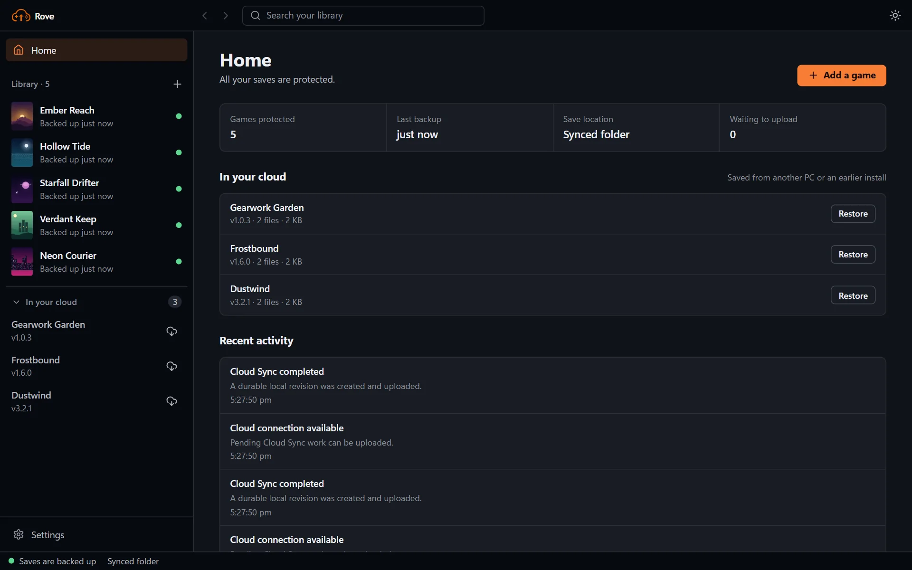
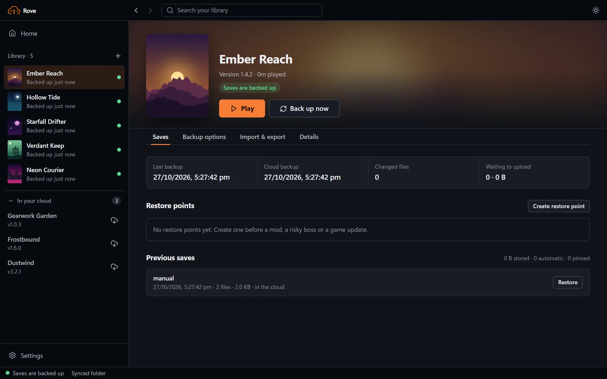
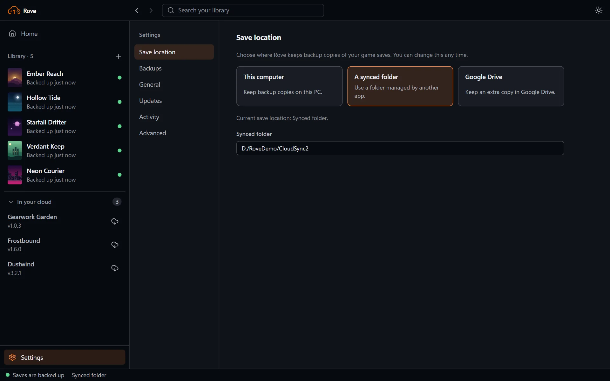

# Rove user guide

Rove keeps a game's save folder in Cloud Sync even when the game or store does not provide cloud saves. Cloud Sync is local first: losing Internet access never prevents a local revision from being created.

## Tour of the app

Rove is laid out like a desktop program:

- **Toolbar:** back and forward, a search box that filters your library, and the light/dark switch.
- **Sidebar:** your games with a live backup status for each, an **In your cloud** list of games you can restore, and **Settings** at the bottom.
- **Home:** an overview of protected games, the last backup, your save location, anything that needs attention, and recent activity.
- **Game page:** **Play** and **Back up now** up front, with tabs for **Saves**, **Backup options**, **Import & export** and **Details**.
- **Status bar:** whether your saves are backed up, where they are kept, and what is waiting to upload.

Settings opens a preferences-style screen with its own section list: Save location, Backups, General, Updates, Activity and Advanced.

## First setup

1. Open **Games**, add a game, select its save folder, and select its executable.
2. Open **Settings** and choose a sync destination:
   - **Local only** needs no account.
   - **Google Drive** opens a normal Google sign-in. No key or developer setup is required.
   - **Synced folder** asks for a folder already managed by OneDrive, Dropbox, Syncthing, or a similar tool.
3. Keep the default **Balanced / 10 minutes** policy unless you have a reason to change it.
4. Choose **Sync now** once to create the first local revision.

## Policies

| Policy | During play | After exit |
| --- | --- | --- |
| Balanced | Captures dirty, stable files at the configured interval; default 10 minutes. | Final sync after five quiet seconds. |
| Exit only | Does not read save files during play. | Final sync after exit. |
| Continuous | Captures after five quiet seconds, no more than once every two minutes. | Final sync after exit. |
| Manual | Only **Sync now** and Recovery Points. | No automatic exit capture. |

Rove watches only running tracked games. An event marks a path dirty; it does not immediately scan or hash the whole save folder. Files must have unchanged size and modification time across two checks one second apart before capture.

## Offline behavior

The Home screen, Game screen, sidebar, and tray distinguish local sync from cloud upload. The sidebar's main **Cloud Sync** label shows the active saved destination (`Local only`, `Google Drive`, or `Synced folder`); the line beneath it is the current health such as `online`, `reconnecting`, `offline`, or `paused`. Connecting Google Drive applies immediately; selecting any other destination in Settings is a draft until **Save settings** succeeds, and Settings explicitly shows both the active destination and any pending selection.

- **Last local sync** means a revision is safe in the local vault.
- **Last cloud upload** means a provider accepted the revision.
- **Pending uploads** remain in SQLite across app exits and Windows restarts.
- When connectivity returns, a Windows network-change event requests an immediate retry. Otherwise, transient errors use increasing delays up to 15 minutes.
- Authentication and quota problems stop automatic retry until you reconnect or make space. Local sync continues.

The states shown are **Local only**, **Online**, **Offline**, **Reconnecting**, **Authentication required**, **Rate limited**, **Quota full**, **Provider unavailable**, and **Remote data problem**.

## Pause controls

- **Pause cloud uploads** keeps local capture and Recovery Points running while provider work queues.
- **Pause all sync** stops capture and provider workers, but keeps dirty state, revisions, jobs, and the tray process.
- A pause can last one hour, until next login, or until manually resumed.
- Settings controls the global state. Each Game page has its own pause state layered over the global state.

Defaults are Cloud Sync enabled, automatic reconnect enabled, upload on metered connections disabled, remote check before a Rove launch enabled, important-notification preference enabled, and conflict review required. Metered-network enforcement and native toast delivery are not active in this build; the settings are retained for the Windows integration that will enforce them.

## Launching

**Play with pre-check** gives the provider up to five seconds to report its head. If a newer clean revision exists, Rove creates a pre-restore Recovery Point and applies it before launch. Provider failure never blocks forever: the UI offers explicit offline play.

Games launched externally are still detected and synced. Only a Rove launch guarantees the pre-launch provider check.

## Recovery Points and history

A Recovery Point is a named pinned revision. It is never removed automatically. The latest three unpinned automatic/final revision records remain visible; physical content objects are deduplicated and are not automatically reclaimed yet.

The Game page reports unique retained content, automatic record count, pinned count, and pending-upload bytes. Reclaimable space remains zero until the quarantine cleanup implementation is activated.

Restore is exact: files absent from the selected revision are removed. Rove refuses restore while the game is running, creates a pre-restore Recovery Point, verifies object hashes, and uses temporary files or a staging directory before replacement.

Home and the sidebar's **In your cloud** list show provider profiles without relying on an old local game ID. A cloud-only profile can be restored to a new or empty folder. Non-empty fresh-install destinations are refused; add the destination as a game first so conflicts can be reviewed.

See [Recovery and safe restore](end-users/RECOVERY.md).

## Conflicts

If the same relative path changed on two devices, Rove preserves both states and creates a review item:

- **Keep local** publishes the current local file.
- **Use remote** applies the remote file or deletion.
- **Keep both** keeps local and places the remote copy beside it with a conflict suffix.

No conflicting incoming file overwrites local data without this explicit action.

## ZIP and legacy backups

Manual ZIP export/import remains available. Replace import requires confirmation, refuses a running game, creates a Recovery Point, extracts into a sibling staging directory, then swaps it into place. Merge import keeps files not present in the ZIP.

Old snapshot vaults are not scheduled and new legacy snapshots cannot be created. Existing entries appear under **Legacy local backups** and may be restored or explicitly removed. Existing ZIP and snapshot data is never silently deleted or converted.

## Windows startup and tray

**Start with Windows** uses the native Tauri autostart integration. Windows launches `Rove.exe --background`; no main window is shown. A per-user Windows mutex prevents two daemons.

The current tray provides status, provider/pending count, **Sync now**, **Create Recovery Point** for running games, **Retry connection**, **Review conflicts**, upload pause, all-sync pause, a single-running-game pause, resume, open, and quit. Its updates are event-driven rather than polled.

## Application updates

Rove checks stable GitHub Releases when the desktop opens and before launching a game if its last successful check is older than six hours. A launch-time check stops after three seconds and never prevents play.

When an update is available before launch, choose **Download and play**, **Not now**, or **Cancel launch**. Downloading can continue while the game runs, but installation remains disabled until tracked games close and active local sync finishes. A verified completed download remains ready after an app restart. Installation replaces the existing program in place and restarts Rove; do not uninstall first. Failed and offline checks leave the installed version and all Cloud Sync data unchanged.

When a signed download completes, Rove opens a **What's new** window with the release notes. Choose **Install update** when nothing is running, or **Install later** to keep the verified update ready. You can reopen the notes from the update banner or Settings at any time.

Settings > **Application updates** shows the installed/available versions, check time, release notes, byte progress, automatic-check option, retry action, and install action. Source/development builds intentionally cannot install releases.

## Activity and diagnostics

Activity contains useful Cloud Sync, recovery, provider, conflict, and pause events. Routine requests, watcher noise, PIDs, database paths, and internal scans are excluded.

**Copy diagnostics** produces a sanitized report containing provider state and job stages. It excludes OAuth tokens, credentials, save contents, usernames, and complete personal paths.

For common problems, see [FAQ and troubleshooting](end-users/FAQ.md).
