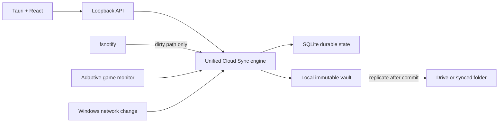

# Architecture and Cloud Sync workflow

## Capture

The watcher maps a path to the longest matching game root. File cache entries store path, size, modification time, Windows file ID field, SHA-256, dirty state, and last revision. A capture scans metadata, waits one shared second, confirms stability, streams dirty content through SHA-256 and object staging, then confirms metadata again.

`ReconcileWithStore` publishes the local object set and immutable manifest before moving local head. The revision metadata and durable job receive the revision ID before provider work.

## Provider replication

`ReplicateRevision` reads the already committed local manifest and streams objects to a provider. It writes objects, manifest, per-device head, then compatibility head. Rerun is idempotent because content hashes and logical file names are stable.

## Offline queue

Provider errors are classified into stable codes and health states. Retryable jobs retain the source revision ID, so retry skips local capture. Authentication/quota failures stop spinning. Network change bypasses the current delay once.

## Event batching and cadence

`NotifyFileEvent` only records a path in an in-memory per-game set. `flushDirty` writes the set to SQLite in a single transaction on every two-second scheduler tick and immediately before each capture, so write-heavy games cost one commit per tick rather than one per event. The durable job queue is polled every fifth tick. The game monitor samples processes every five seconds while idle and four while a game runs. The UI skips polling while hidden and refreshes the provider game list (`/recovery-library`) on a 60-second cadence.

## Compatibility

Portable game profiles carry `schemaVersion`. `MaxProfileSchema` is the newest layout a build reads; newer profiles are listed with `requiresUpdate` and `RestoreAndTrack` refuses them. Settings imports with a newer schema are rejected. Older layouts must stay readable.

## Restore

Tracked restore creates a pre-restore pinned revision and applies through verified temporary files. Fresh cloud restore (Library → In your cloud) materializes the full remote head in a sibling staging directory and publishes it only to a new/empty destination.

## Portable game profile and presentation data

Each stable Sync ID owns a `game.json` profile. It contains display metadata (name, optional version, executable basename, tokenized path hint, latest revision, and aggregate playtime) but never an absolute personal path. The physical provider directory remains keyed by Sync ID so renaming a title cannot break pairing. Small cover art is stored separately as `cover.png`; profile metadata only declares whether it is available. Add-game attempts to read a PNG icon from the selected Windows executable using `winres`; extraction failure is non-fatal and the client renders a deterministic generated cover.

Playtime does not use last-writer-wins `game.json` state. Each installation writes `playtime/<deviceId>.json` with its cumulative contribution; profile publication takes the maximum current value per device and sums device records. A newly restored game starts with no local contribution, so it cannot re-upload the already-aggregated portable total as new time.

`GET /storage/summary` aggregates Rove-managed logical bytes over the tracked library. It excludes unrelated Google Drive/synced-folder account content. Recovery's restore-and-track endpoint stages the revision, then creates a local game entry paired to the profile Sync ID.

## Scheduling

- engine scheduling tick: one second, doing only due-state checks;
- provider metadata fallback: engine health/retry deadlines rather than a global 30-second full scan;
- Balanced: configured minutes, default 10;
- Continuous: five-second quiet time and two-minute minimum;
- exit: five seconds without save activity;
- full closed-game 24-hour content auditing is represented in the design but is not yet implemented as a separate audit scheduler.

## Legacy boundary

Auto-ZIP and snapshot schedulers are no longer started. Manual ZIP remains. Legacy snapshot list/restore/delete remains, while creation returns HTTP 410. Existing vault files are untouched.
