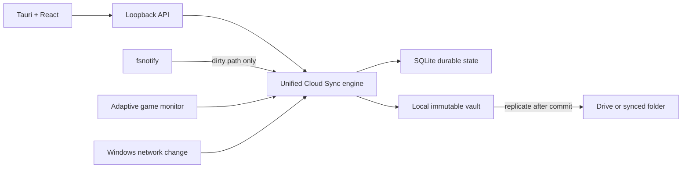

# Architecture and Cloud Sync workflow

## Capture

The watcher maps a path to the longest matching game root. File cache entries store path, size, modification time, Windows file ID field, SHA-256, dirty state, and last revision. A capture scans metadata, waits one shared second, confirms stability, streams dirty content through SHA-256 and object staging, then confirms metadata again.

`ReconcileWithStore` publishes the local object set and immutable manifest before moving local head. The revision metadata and durable job receive the revision ID before provider work.

## Provider replication

`ReplicateRevision` reads the already committed local manifest and streams objects to a provider. It writes objects, manifest, per-device head, then compatibility head. Rerun is idempotent because content hashes and logical file names are stable.

## Offline queue

Provider errors are classified into stable codes and health states. Retryable jobs retain the source revision ID, so retry skips local capture. Authentication/quota failures stop spinning. Network change bypasses the current delay once.

## Restore

Tracked restore creates a pre-restore pinned revision and applies through verified temporary files. Fresh Recovery Library restore materializes the full remote head in a sibling staging directory and publishes it only to a new/empty destination.

## Scheduling

- engine scheduling tick: one second, doing only due-state checks;
- provider metadata fallback: engine health/retry deadlines rather than a global 30-second full scan;
- Balanced: configured minutes, default 10;
- Continuous: five-second quiet time and two-minute minimum;
- exit: five seconds without save activity;
- full closed-game 24-hour content auditing is represented in the design but is not yet implemented as a separate audit scheduler.

## Legacy boundary

Auto-ZIP and snapshot schedulers are no longer started. Manual ZIP remains. Legacy snapshot list/restore/delete remains, while creation returns HTTP 410. Existing vault files are untouched.
