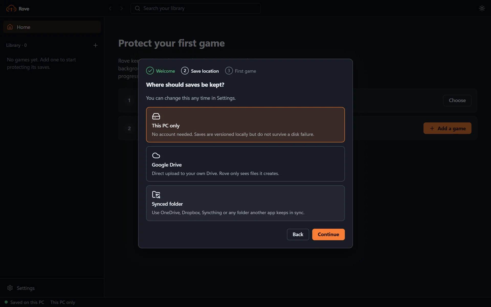

# Getting started

## First-run setup

On first launch Rove shows a short setup: a welcome, a choice of save location (this PC only, Google Drive, or a synced folder), and your first game. If saves already exist in the chosen location, finish setup and restore them from **Library → In your cloud**. You can skip setup and change everything later in Settings.

## Choose the save folder

Add the folder containing actual progress files, not the installation folder unless the game stores saves there. Select the executable so Rove can detect play/exit and refuse unsafe restore.

## Choose a destination

- Start with **Local only** to test safely without an account.
- Use **Connect Google Drive** for direct Cloud Sync; it becomes your save location as soon as sign-in finishes. The app asks for normal Google consent and uses only files it creates.
- Use **Synced folder** if OneDrive, Dropbox, Syncthing, or another client already syncs a folder between PCs.

No option requires a VPS, a user-managed server, or user-supplied API keys.

## Recommended first run

1. Keep **Balanced**, 10 minutes, and exit sync enabled.
2. Choose **Sync now** while the game is closed.
3. Confirm that **Last local sync** is populated.
4. For a cloud target, wait for **Last cloud upload** or check the pending count.
5. Create a named Recovery Point before a risky mod, boss, or game update.

Rove application updates are optional. If prompted before launching a game, **Download and play** starts the game normally and downloads the signed update in the background. Install it later after the game and Cloud Sync work finish; no manual uninstall is needed.

## Second computer

Connect the same provider, then look under **In your cloud** on Home or in the sidebar. Choose **Restore** next to the game, then select the newly installed executable and a new or empty save folder. Rove restores the revision and links the local game to its existing cloud identity in one confirmation flow. If the destination already contains saves, add it as a game and review differences; fresh recovery deliberately refuses non-empty folders.

## Different Rove versions

Rove stamps every cloud profile with a format version. A computer running an older Rove shows saves from a newer one as **Needs a newer Rove** and will not restore them; update Rove and they become available. Saves from older versions always remain readable.

## Covers, versions, and playtime

Game version is optional. Rove first uses a manual cover image, otherwise the selected executable's icon, then a stable generated cover with the game's initials. Playtime is published as separate device records and merged for the total shown in recovery metadata; two computers do not overwrite each other's time.

## Low-impact choice

Choose **Exit only** if you want no save-file reads during gameplay. You lose crash-time checkpoints but still receive a final sync after a normal detected exit. Balanced is the safer default for small RPG/action-game save folders.
